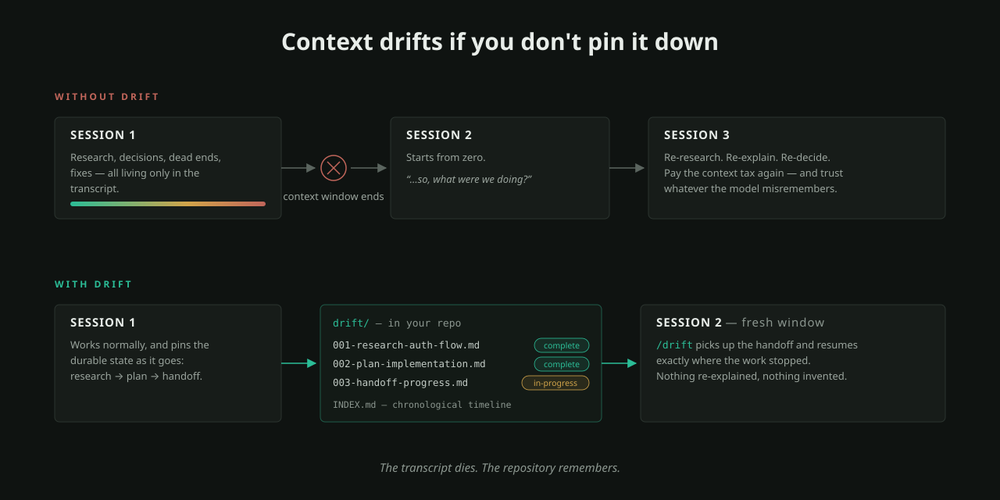
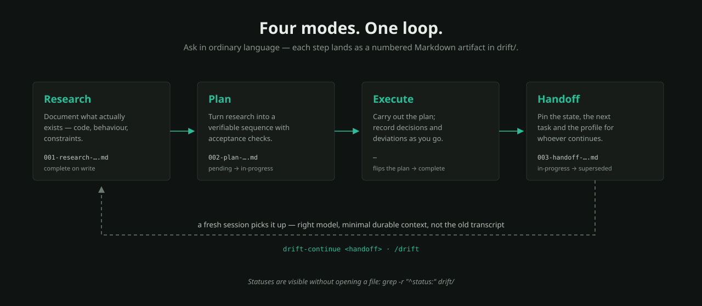
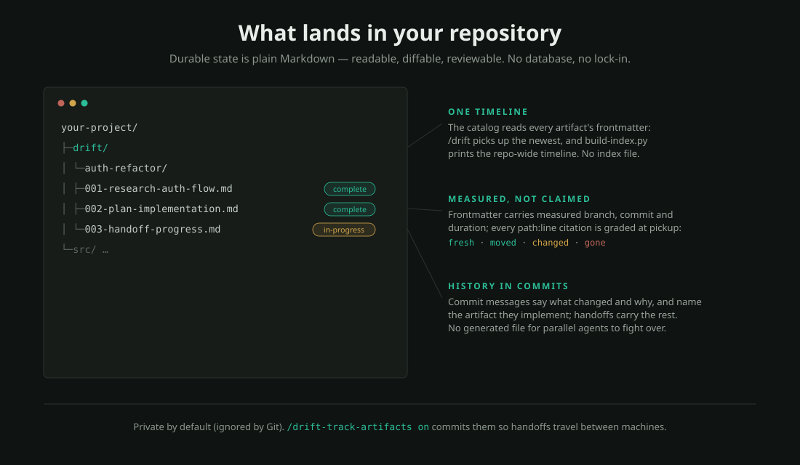
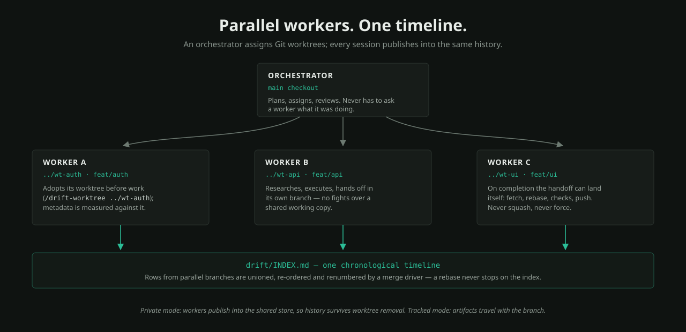
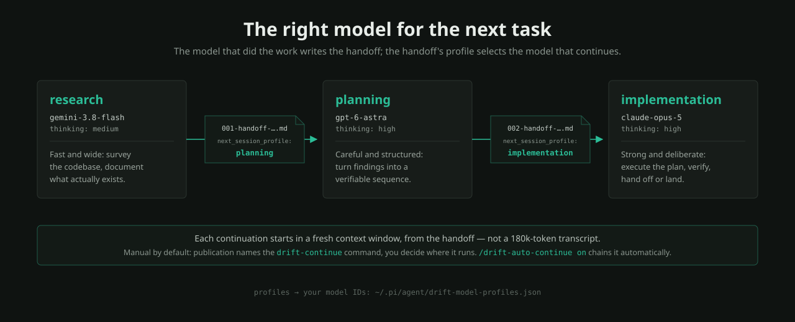

<p align="center">
  
</p>

<h3 align="center"><em>Context drifts if you don't pin it down</em></h3>

Drift preserves the useful state of multi-session coding work: research,
decisions, changes, and the next task. Its portable skill guides the workflow;
the Pi extension owns session metadata and artifact publication.



## Install

Drift is one portable skill plus optional host automation. Clone it once; every
host reads the same checkout. Git and Python 3.7+ are required everywhere.

```sh
git clone https://github.com/coylemichael/drift ~/projects/drift
```

**Pi** (0.85.1+, Node 22.18+) — owns session records and artifact publication:

```sh
pi install ~/projects/drift
```

Restart Pi (or `/reload`) after installing or updating the checkout; a running
extension keeps the tools it loaded. `pi remove ~/projects/drift` uninstalls
without touching the checkout, artifacts, or session records.

Keep Pi current where you can. Drift is developed and tested against the Pi
version pinned in `package-lock.json` (1.1.0 today); releases from 0.85.1 still
pass the suite, but Pi's queued-input and skill handling has changed between
releases, so an old Pi is the first thing to rule out when something misbehaves;
Drift warns once per session when the running Pi is older than that version.

**Claude Code, including Zed's `claude-acp` agent** — a symlink loads the
checkout as the `drift` plugin on the next session, with no install step:

```sh
ln -s ~/projects/drift ~/.claude/skills/drift
```

Workflow selection is self-healing on Pi: the extension binds Drift's skill
entry to the workflow shipped in the same package, so an older standalone copy
cannot silently supply an outdated one. Stale-copy retirement, the Claude
`/drift` command file and the rest of the per-host fine print:
[docs/install.md](docs/install.md).

Naming: `skills/drift/` in this checkout is the skill; `drift/` inside a target
repository holds that repository's artifacts.

## Commands (Pi)

Every user-facing command on one page; each links to its reference page. The
configuration commands are per repository, write `.drift.json`, and a bare
command (or `status`) only reports.

| Command | What it does |
| --- | --- |
| `/drift [artifact \| request]` | The entry point: picks up the newest artifact in `drift/INDEX.md`, the one you name, or passes any other request to the Drift skill. |
| `drift-continue <handoff>` | Continues a published handoff, switching to its declared `next_session_profile` before inference. Bare on purpose — no leading slash — so hosts that reserve `/` pass it through; run it in a fresh thread. ([details](docs/continuation.md)) |
| `/drift-worktree [status \| <path>]` | Shows the launch repo, active Drift root and record, or adopts an existing linked worktree of the same repository. ([details](docs/worktrees.md)) |
| `/drift-track-artifacts on\|off\|status` | Whether this repo's `drift/` artifacts are committed to Git or stay private (ignored). ([details](docs/artifact-git-policy.md)) |
| `/drift-changelog on\|off\|status` | Whether `CHANGELOG.md` is generated from `changelog.d/` fragments (never automatic: on where a committed `CHANGELOG.md` carries Drift's markers or `.drift.json` turns it on). ([details](docs/changelog.md)) |
| `/drift-auto-continue on\|off\|status` | Whether publishing a profiled handoff automatically compacts and continues in a fresh context window. Off by default: you decide if a handoff goes into a new thread. ([details](docs/continuation.md)) |
| `/drift-land` | Lands the current branch on origin's default branch: fetch, rebase, verify, check, push; never squash or force. ([details](docs/landing.md)) |

## Workflow



| Mode | Use |
| --- | --- |
| Research | `skills/drift/research.md` — document what exists. |
| Plan | `skills/drift/plan.md` — turn research into a verifiable sequence. |
| Execute | `skills/drift/execute.md` — carry out a plan or handoff. |
| Handoff | `skills/drift/handoff.md` — record current state for the next task. |

Ask for the appropriate Drift workflow in ordinary language. Artifacts are kept
in the target repository, not the skill checkout:

```text
drift/
  INDEX.md
  auth-refactor/
    001-research-auth-flow.md
    002-plan-implementation.md
    003-handoff-progress.md
```

`INDEX.md` is the repository-wide chronological timeline.

Each artifact's frontmatter also carries a `status` — `pending`, `in-progress`,
`complete` or `superseded` — so you can see which plans have run and which
handoffs are still live without opening files:

```sh
grep -r "^status:" drift/
```

Plans start `pending` and execution flips them to `in-progress`, then
`complete`; handoffs are written `in-progress` or `complete` and become
`superseded` when a later handoff resumes them; research is `complete` on write.
Flipping `status` is the one in-place edit Drift makes to an existing artifact.
It is not an index column, because index rows never change.



### Artifact Git policy (per repository)

Artifacts are private by default: Drift keeps `drift/` ignored. Committing
`{ "trackArtifacts": true }` in a repository-root `.drift.json` lets handoffs
travel between machines; on Pi, `/drift-track-artifacts on|off|status` makes
the `.gitignore` edits for you and verifies Git agrees, staging nothing. A
tracked `drift/INDEX.md` gets a merge driver so parallel branches union their
rows instead of conflicting, and linked worktrees in private mode publish into
the main worktree's shared store. Review artifacts before committing: handoffs
can contain private project context even though they must not contain
credentials. Exact rules, edge cases and the driver setup for other hosts:
[docs/artifact-git-policy.md](docs/artifact-git-policy.md).

### Changelog from fragments (per repository)

Parallel agents editing one `[Unreleased]` section lose entries on every
rebase, so in a repository with an `origin` remote and a root `CHANGELOG.md`
Drift generates the changelog instead: one fragment per change in
`changelog.d/`, rebuilt between marker comments at each publication, grouped by
version tag, with the project's own text outside the markers preserved byte for
byte. A local-only repository is left alone; `/drift-changelog on|off|status`
overrides the trigger either way. Fragment format, hand-edit detection and the
merge driver: [docs/changelog.md](docs/changelog.md).

### Citation anchors (per artifact)

An artifact's `path:line` references rot as the code moves on. At publication
every citation is anchored — range, content hash, search needle — and when an
artifact is picked up each one is graded in a single note: `fresh` (proven by
hash), `moved` (forwarded to its new location), `changed`, `gone` or
`uncertain`. The check is a report, never a gate: it blocks nothing and writes
nothing to the repository. Grading rules, the standalone checker and the local
metrics ledger: [docs/citation-anchors.md](docs/citation-anchors.md).

### Landing (per repository)

Drift already knows when a unit of work ends: the handoff that completes the
interval. With a one-time `{ "land": { "auto": true, "check": "pytest -q" } }`
opt-in, that handoff lands itself: fetch, rebase onto origin's default branch,
verify derived files, guard against reverting other threads' work, run the
repo's checks, push — never squash, never force. A real conflict or a tripped
guard halts with the branch as it was and says what blocked. `/drift-land` is
the same sequence as a manual command, and landings are serialised across a
repository's worktrees. The full sequence, the guard, and what the one
`drift: publish` commit may contain: [docs/landing.md](docs/landing.md).

## Worktrees for parallel workers (Pi)



A common layout: start several Pi ACP sessions in the main checkout, then have
an orchestrator assign each worker an existing linked worktree. A Pi session's
`cwd` is fixed when it starts, so Drift binds a worktree explicitly:

| Form | Effect |
| --- | --- |
| `/drift-worktree` or `/drift-worktree status` | Shows the launch repo, the active Drift root and the record. Read-only. |
| `/drift-worktree <path>` | Adopts that worktree. A relative path resolves from the session's original `cwd`. |
| `drift_worktree { action: "status" }` / `{ action: "adopt", path }` | The same, as a model tool. |

Adoption accepts only the root of an existing worktree of the same repository,
then binds every Drift repository operation to it: metadata, numbering, index,
publication, changelog fragments, the configuration commands and continuation.
Each adoption takes a fresh measured baseline, and the binding survives reload,
resume and compaction. It does not change Pi's `cwd` or the default directory
of the built-in tools, and it is not a sandbox: the adopted branch's
`.drift.json` still controls landing. Workers should adopt their assigned
worktree before any substantive work; the orchestrator can stay in the main
checkout. Full semantics — what adoption accepts, measures, survives and
refuses: [docs/worktrees.md](docs/worktrees.md).

## Profile-directed continuation



A handoff may declare the next task's portable profile: `research`, `planning`,
or `implementation`. The model that performed the work writes its own handoff;
the profile selects the model for the **next** independent task.

By default the chain stops at publication: nothing is queued, the tool result
names the `drift-continue` command, and you decide if, when and in which thread
the work continues. `/drift-auto-continue on` opts a repository in: publishing
a profiled handoff then compacts to a fresh context window, resolves the
profile through your model map (`~/.pi/agent/drift-model-profiles.json`), and
continues the recorded work with minimal durable context rather than the old
transcript. Validation failures leave the handoff intact and name the manual
recovery. The profile file format, trusted-project overrides and the current
starting policy: [docs/continuation.md](docs/continuation.md).

## User decision checkpoints

Drift asks and waits when work reveals a genuine requirement ambiguity, material
plan/scope deviation, public-contract or data-model change, security/destructive
risk, external integration/cost, priority change, or reversal of an accepted
decision. It gives the evidence, bounded options, and one clear question.

Routine implementation choices remain with the agent and are recorded in the
artifact. A pending user decision never triggers a profiled automatic handoff.

## Picking up work: `/drift`

On Pi, `/drift` is the one entry point:

| You type | Drift does |
| --- | --- |
| `/drift` | Picks the newest artifact in `drift/INDEX.md`: resumes an `in-progress` handoff, executes a `pending` plan, plans from research. If it is already `complete`, it says so and asks rather than reopening it. |
| `/drift <link, path or file name>` | Picks up that artifact; anything else you write is passed on as your note. Zed `@` mentions and Windows paths work. |
| `/drift <anything else>` | An ordinary Drift request, like `/skill:drift`. |

The choice is made in code, not by the model, and is announced ("Drift: picking up …").
It keeps the current model; `drift-continue <handoff>` is the variant that switches
to the handoff's `next_session_profile`. In Zed, `/drift` appears in the `/` menu
as a Pi prompt command and needs no adapter patch. Other hosts follow the same
pick-up rule from `SKILL.md` when you ask to "pick up" without naming an artifact.

## What Pi automates

- A durable record keyed to Pi's real session ID and launch repository, with an
  explicitly adopted worktree as the active Drift root (`/drift-worktree`).
- `/drift`, which picks up the newest artifact (or the one you name) and
  routes it to the right workflow.
- A current `drift/INDEX.md` at session start: when the repo already holds
  artifacts (for example, written by Claude or Zed's native agent) and the
  index is missing or stale, it is rebuilt before the record's baseline is taken.
- Measured start metadata and dirty-file fingerprints that survive reload,
  resume, and compaction.
- Bounded Drift context on normal model requests and checkpoints after settled
  turns or graceful teardown. The context is tiered: a session records silently
  behind a minimal note until a deterministic signal — existing artifacts,
  `.drift.json`, another engaged session, work landing in the tree, or explicit
  Drift use — engages the full lifecycle context. An unchanged context keeps its
  place in the conversation instead of re-arriving every turn. Observed behavior
  from live sessions is transcribed in
  [docs/field-observations.md](docs/field-observations.md).
- `drift_publish`, which validates artifact paths, writes measured frontmatter,
  allocates numbers, rebuilds the index, and retains retryable receipts.

A published handoff completes only its current work interval. Pi conversation
logs and session records are never deleted by Drift. The extension is inactive
outside Git but attaches automatically when a repository appears at the launch
directory (for example, after cloning into an empty folder); the skill remains
usable manually in other agents.

## Development

```sh
npm test
npm run typecheck
npm run lint
python3 -I scripts/build-index.py /path/to/project/drift --check
git diff --check
```

CI runs the lint, typecheck and test steps on Ubuntu, macOS and Windows for
every push and pull request; the real-Pi tests use the Pi version the lockfile
installs (`PI_TEST_BINARY=pi npm test` runs them against the machine's own).

`npm test` uses temporary repositories and loopback model fixtures. It covers
record/publication safety and actual Pi RPC lifecycle, model selection, reload,
resume, and compaction. Stale-skill regressions cover automatic runtime binding,
explicit skill invocation, damaged-workflow recovery, disabled discovery, and a
three-handoff chain that stops at completion. Set `PI_TEST_ACP=/path/to/pi-acp/dist/index.js` to also
run the installed ACP checks.
